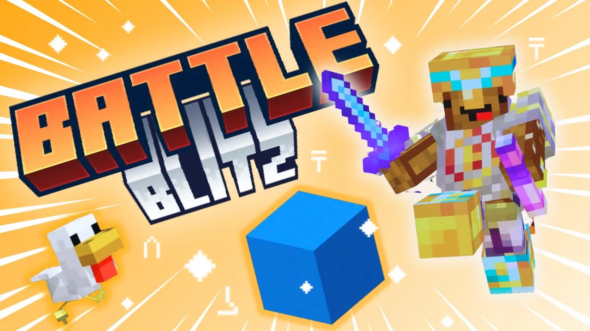

# BATTLE BLITZ

BATTLE BLITZ, is a Minecraft Java Edition team-based PVP minigame where players fight across 3-5 rounds to collect the most BATTLESTARS, obtainable through kills and dominating the center. (inspired by MCC's Battle Box)

Players can choose from a diverse set of 13+ classes with special abilities and unique mechanics, fight on 7 different maps, and use different power-ups, for a unique gameplay experience every round.

This datapack is not independent and requires the built map to work. See https://www.planetminecraft.com/project/battle-blitz-minigame-1-21-1/ for the installation link and more details. The pack is saved here for documentation.

Created by @fakebaguette
